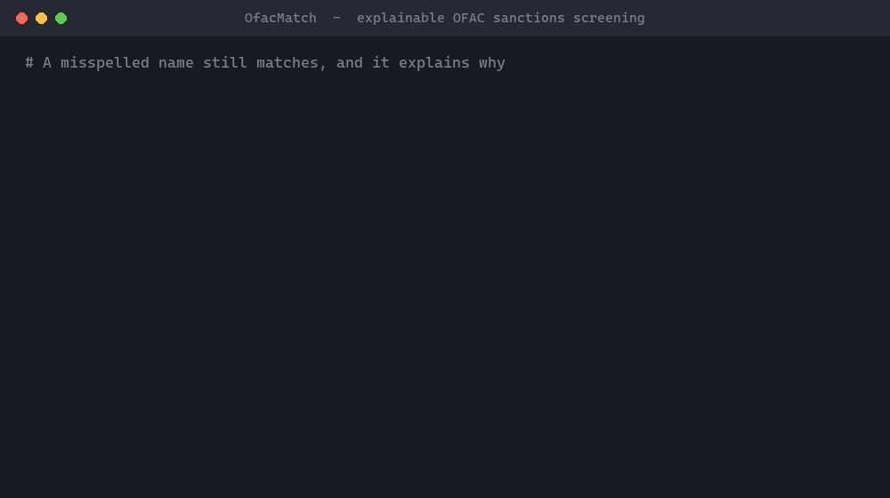

# OfacMatch

[](https://doi.org/10.5281/zenodo.23926803)
[](https://doi.org/10.5281/zenodo.23930926)

[](https://mcprush.com/to/ofac-match-mcp?ref=badge)

OFAC sanctions name screening for .NET that tells you *why* a name matched.



**[Try it in your browser](https://krunalsolanki.github.io/ofac-match/)**: no install, and the names you type never leave your browser.

## Why I built this

I spent ten years building title and mortgage systems at First American, including OFAC screening that stops a loan from going to someone on the Treasury's sanctions list. Name matching sounds simple until a compliance analyst asks why a name was flagged, or why a misspelled one wasn't.

Many teams still search OFAC's website by hand or rely on screening logic they can't see inside. I wanted something small and open: load the official list, score names the way OFAC describes in its own [FAQ](https://ofac.treasury.gov/faqs/topic/1636), and show the reasoning behind every score.

## What it does

OfacMatch downloads the Specially Designated Nationals (SDN) list from OFAC, screens names against it, and gives each potential match a score from 0 to 100, the same scale OFAC's [search tool](https://sanctionssearch.ofac.treas.gov/) uses. Every match comes with an explanation: which name or alias it hit, and how each part of the name paired up.

It handles the messy parts of real names: accents, `LAST, First` ordering, apostrophes and hyphens, titles like "Dr.", company endings like LLC or LTD (even misspelled), and aliases. If you pass a year of birth or country that disagrees with the listed record, the match is flagged rather than hidden, because that call belongs to a person.

It has no dependencies, runs inside your own process (names never leave your systems), and works on modern .NET as well as .NET Framework 4.7.2+.

I measured it on the real list rather than guessing, on names it was never tuned on: at a threshold of 85 it finds all 4,235 realistic variations of listed names in a held-out test, and 99.6% of 2,160 harder ones such as a wrong first letter, a nickname or an extra middle name. It is also compared with eight standard name-matching methods. The [results](#results-on-the-real-sdn-list) below have the details, including where a simpler method does better.

Version 2.0 changes how a searched name with extra parts is scored; see the [changelog](https://github.com/krunalsolanki/ofac-match/blob/main/CHANGELOG.md). Feedback, bug reports and name variations that score badly are very welcome.

> OfacMatch helps you screen; it doesn't make compliance decisions and isn't legal advice. A score says how alike two names are written, not whether two records are the same person. Pick your threshold from your own risk assessment and have someone review every potential match. More in [Using OfacMatch responsibly](https://github.com/krunalsolanki/ofac-match/blob/main/docs/compliance-notes.md).

## Quick start

```bash
dotnet add package OfacMatch
```

```csharp
using OfacMatch.Data;
using OfacMatch.Screening;

using var http = new HttpClient();
var list = await SanctionsList.DownloadAsync(http, saveToDirectory: "ofac-data");

var screener = new SanctionsScreener(list, new ScreeningOptions { MinScore = 85 });

foreach (var match in screener.Screen("Aymen Zawahri"))
{
    Console.WriteLine(match.Explain());
}
```

Output against the SDN list published 27 October 2026:

```text
Score 95.8 via NameParts against Primary name "AL ZAWAHIRI, Dr. Ayman"
  Entry 2676: AL ZAWAHIRI, Dr. Ayman (Individual; programs: SDGT)
  Full-name score 84.5; name-parts score 95.8
  AYMEN -> AYMAN: similarity 0.907, sounds alike
  ZAWAHRI -> ZAWAHIRI: similarity 0.946, sounds alike
```

[How scoring works](https://github.com/krunalsolanki/ofac-match/blob/main/docs/how-scoring-works.md) walks through this example step by step.

### Screening with more context

```csharp
var request = new ScreeningRequest("John Michael Doe")
{
    Type = EntryType.Individual, // a borrower is a person, so skip companies and vessels
    YearOfBirth = 1971,          // flags matches whose listed dates of birth disagree
    Country = "United States",   // flags matches whose listed addresses are all elsewhere
};

var matches = screener.Screen(request);
```

### Offline use

```csharp
var list = SanctionsList.LoadFromDirectory("ofac-data"); // SDN.CSV, ALT.CSV, ADD.CSV
```

OFAC updates the list often. Reload it at least daily, and screen against the current list before every decision.

### Use it from an AI assistant (MCP server)

`OfacMatch.Mcp` lets Claude, GitHub Copilot and other [MCP](https://modelcontextprotocol.io/) clients screen names, look up SDN entries and explain scores. It runs locally and needs no API key.

**Claude Desktop:** download the extension for your computer from the [latest release](https://github.com/krunalsolanki/ofac-match/releases/latest) (`ofac-match-windows.mcpb` or `ofac-match-mac-*.mcpb`) and double-click it. No .NET or config file needed.

**Claude Code plugin** (adds the server plus a skill for reporting results responsibly; needs the .NET 10 SDK):

```
/plugin install ofac-match --marketplace krunalsolanki/ofac-match
```

**Claude Code and other clients** (needs the .NET 10 SDK):

```bash
claude mcp add ofac-match -- dnx OfacMatch.Mcp --yes
```

Tools: `screen_name`, `screen_names`, `get_sanctions_entry`, `compare_names`, `get_list_info`. See the [MCP server guide](https://github.com/krunalsolanki/ofac-match/blob/main/src/OfacMatch.Mcp/README.md) for other clients and settings.

### Command line

```bash
dotnet run --project samples/OfacMatch.Cli -- "Aymen Zawahri" --min 85 --yob 1951
```

## Results on the real SDN list

OfacMatch was improved on a development set of names, then frozen and tested once on a separate held-out set: 600 other listed parties (400 individuals, 200 companies) and 3,000 ordinary names from a vocabulary never used during development, against the SDN list published 27 October 2026. The [evaluation protocol](https://github.com/krunalsolanki/ofac-match/blob/main/docs/evaluation-protocol.md) explains the rules.

| Threshold | Variations found (4,235) | Harder variations found (2,160) | Two-part ordinary names that alert | Three-part ordinary names that alert |
|---|---:|---:|---:|---:|
| 80 | 100.0% | 99.9% | 75.7% | 51.0% |
| 85 | 100.0% | 99.6% | 37.5% | 10.3% |
| 90 | 100.0% | 98.4% | 10.2% | 2.2% |
| 95 | 99.6% | 83.4% | 2.1% | 0.0% |

- **Variations:** exact, surname first, lower case without punctuation, one wrong letter, two letters swapped, one letter missing, different transliteration, joined particles ("ALZAWAHIRI"), middle name left out, and changed company suffix.
- **Harder variations:** wrong first letter ("Qassim" for "Kassim"), two wrong letters, a nickname or the same name in another language ("Sasha" for "Aleksandr"), first name as an initial, and an extra middle name that is not on the list.

**Compared with other methods.** The same cases were screened with eight standard methods, including Levenshtein, Jaro-Winkler, RapidFuzz-style token ratios and trigram TF-IDF ([full comparison](https://github.com/krunalsolanki/ofac-match/blob/main/docs/baselines-heldout.md)). To compare them fairly, each method gets the threshold at which the same share of ordinary names alerts. The strongest simple method, a token set ratio, found slightly more of the harder variations than OfacMatch (98.9% against 96.7% when 5% of ordinary names alert). OfacMatch raised clearly fewer alerts on names that share a first name with a listed person, such as "Ayman Smith" (11.9% against 16.4%), and it explains every score. For a review team, fewer alerts and a reason for each one is usually worth more than the last two points of recall, but that trade-off is yours to make.

Three things stand out in these numbers. Screening on a name alone alerts a lot: at 85, more than a third of ordinary two-part names look like *something* on the list. Date of birth and country are what let a reviewer clear those quickly. Moving the threshold from 85 to 90 cut those alerts by about three quarters while still finding every variation and 98.4% of the harder ones, so the threshold deserves a deliberate choice rather than a default. And since 2.0, a listed two-part name inside a longer searched name scores high, so three-part names alert more often at 85 than in 0.1.2 (10.3% against 3.3%).

You can re-run it yourself on the development set:

```bash
dotnet run -c Release --project eval/OfacMatch.Evaluation -- --data ofac-data --out docs/evaluation.md
dotnet run -c Release --project eval/OfacMatch.Evaluation -- --data ofac-data --baselines --out docs/baselines.md
```

## Documentation

| Guide | What it covers |
|---|---|
| [Why OfacMatch](https://github.com/krunalsolanki/ofac-match/blob/main/docs/why-ofacmatch.md) | Benefits and comparison with other options |
| [How scoring works](https://github.com/krunalsolanki/ofac-match/blob/main/docs/how-scoring-works.md) | Every step, with a worked example |
| [API and configuration reference](https://github.com/krunalsolanki/ofac-match/blob/main/docs/reference.md) | Types, options and defaults |
| [Using OfacMatch responsibly](https://github.com/krunalsolanki/ofac-match/blob/main/docs/compliance-notes.md) | Thresholds, review, record keeping, limits |
| [Evaluation protocol](https://github.com/krunalsolanki/ofac-match/blob/main/docs/evaluation-protocol.md) | How the development and held-out sets are kept apart, and how settings were chosen |
| [Held-out results](https://github.com/krunalsolanki/ofac-match/blob/main/docs/evaluation-heldout.md) and [comparison](https://github.com/krunalsolanki/ofac-match/blob/main/docs/baselines-heldout.md) | Results on names never used during development, and against eight standard methods |
| [Development results](https://github.com/krunalsolanki/ofac-match/blob/main/docs/evaluation.md), [comparison](https://github.com/krunalsolanki/ofac-match/blob/main/docs/baselines.md) and [tuning](https://github.com/krunalsolanki/ofac-match/blob/main/docs/tuning.md) | The set used while improving the method |
| [MCP server](https://github.com/krunalsolanki/ofac-match/blob/main/src/OfacMatch.Mcp/README.md) | Using OfacMatch from AI assistants |

## What's next

Things I'd like to work on, roughly in order:

- [x] Evaluation on the real list
- [x] Comparison with standard methods, and a held-out test
- [x] Extra middle names in the search (2.0)
- [ ] Nicknames and equivalent names (Sasha, Aleksandr), from an independent source so they can be tested fairly
- [ ] Give rare words more weight ("CUBA" should count more than "BANK"), to cut alerts on common names
- [ ] Catch typos at the start of company endings ("LTMITED")
- [ ] Support OFAC's Consolidated (non-SDN) list and the Advanced XML format
- [ ] Faster batch screening
- [ ] An ASP.NET Core sample and a `dotnet tool` package

If you'd like to help with any of these, or have a case that scores badly, open an issue. [CONTRIBUTING.md](https://github.com/krunalsolanki/ofac-match/blob/main/CONTRIBUTING.md) has the details.

## Citation

If you use OfacMatch in research or a write-up, please cite the paper:

> Solanki, K. (2026). *Explainable Name Screening Against the OFAC SDN List: An Open Implementation and Reproducible Evaluation* (preprint). Zenodo. https://doi.org/10.5281/zenodo.23930926

```bibtex
@misc{solanki2026ofacmatch,
  author    = {Solanki, Krunal},
  title     = {Explainable Name Screening Against the {OFAC} {SDN} List: An Open Implementation and Reproducible Evaluation},
  year      = {2026},
  publisher = {Zenodo},
  note      = {Preprint},
  doi       = {10.5281/zenodo.23930926},
  url       = {https://doi.org/10.5281/zenodo.23930926}
}
```

To cite the software itself:

> Solanki, K. *OfacMatch: explainable OFAC sanctions name screening* (software). Zenodo. https://doi.org/10.5281/zenodo.23926803

Both DOIs always point to the latest version; each version also has its own DOI on Zenodo. GitHub's **Cite this repository** button gives the paper citation in other formats.

## Credits

Built by [Krunal Solanki](https://github.com/krunalsolanki). The idea and the compliance background come from my work on OFAC screening in mortgage lending.

## Privacy Policy

OfacMatch collects nothing. Names you screen are processed on your own computer, or in your browser for the web page, and are never sent anywhere. The only network request is the download of the public SDN list from OFAC, which is cached locally. Full details: [PRIVACY.md](https://github.com/krunalsolanki/ofac-match/blob/main/PRIVACY.md).

## Data

The SDN list is published by the U.S. Department of the Treasury's Office of Foreign Assets Control. OfacMatch downloads it from OFAC's [Sanctions List Service](https://ofac.treasury.gov/sanctions-list-service) and does not redistribute it. The unit tests use fictional names only.

## License

[Apache License 2.0](https://github.com/krunalsolanki/ofac-match/blob/main/LICENSE)
