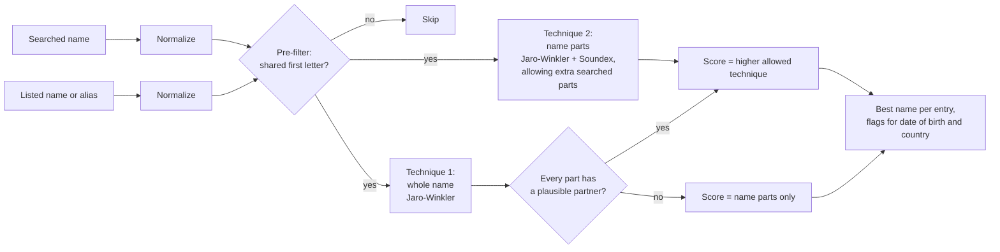

# How scoring works

OfacMatch gives every candidate a score from 0 to 100, where 100 means the names are identical after normalization. This page explains each step with a worked example, so a compliance analyst can reproduce any score by hand.

## The pipeline

## 1. Normalization

Both names go through the same steps:

| Step | Example |
|---|---|
| Accents removed (Unicode decomposition) | José Müller → JOSE MULLER |
| Upper case | al-Zawahiri → AL-ZAWAHIRI |
| Apostrophes dropped | 'ABBAS → ABBAS, O'Neil → ONEIL |
| Other punctuation becomes a space | AL-ZAWAHIRI → AL ZAWAHIRI |
| Honorifics removed | Dr. Ayman → AYMAN |
| Individuals: `LAST, First` turned around | AL ZAWAHIRI, Ayman → AYMAN AL ZAWAHIRI |
| Companies and vessels: legal forms dropped, including one-letter typos in long forms | EXAMPLE TRADING CO., LTD. → EXAMPLE TRADING; ACME COMPALY → ACME |

Legal forms are dropped for companies only, never for individuals.

## 2. Pre-filter

OFAC's FAQ 249 says its tool first keeps candidates whose first letter matches. OfacMatch keeps a listed name if at least one of its parts starts with the same letter as a part of the searched name. This skips most of the list cheaply without dropping reordered names.

## 3. Technique 1: whole name

The normalized names are joined with spaces and compared with [Jaro-Winkler similarity](https://en.wikipedia.org/wiki/Jaro%E2%80%93Winkler_distance). Jaro-Winkler rewards characters in common and in a similar order, plus a bonus of up to four shared leading characters (applied when the Jaro score is above 0.7, as in Winkler's original definition).

## 4. Technique 2: name parts

1. Every searched part is compared with every listed part.
2. A pair's score is its Jaro-Winkler similarity. If the two parts share an [American Soundex](https://en.wikipedia.org/wiki/Soundex) code, the score is raised halfway toward 1: `score = (similarity + 1) / 2`.
3. Parts are paired greedily from the best pair down, and each listed part is used once.
4. The composite is the average of the paired scores, **weighted by the length of each searched part**, so "AL" counts less than "ZAWAHIRI". A searched part with no partner scores 0.
5. A coverage nudge: 95% of the score comes from the composite and 5% scales with how much of the listed name was covered. A full match outranks a partial one, and a partial search still scores high.
6. **Extra searched parts** (since version 2.0). Customers often give a fuller name than the list has. Step 4 counts a searched part with no partner as 0, so "Ayman James Al Zawahiri" would score only 75 against "AL ZAWAHIRI, Ayman". When the search has more parts than a listed name of at least two parts, OfacMatch also scores from the listed name's side:
   - the average of the paired scores, **weighted by the length of each listed part**, so it measures how well the whole listed name was found;
   - reduced by `ExtraPartPenalty` (0.1) times the share of searched letters in parts with no partner.

   The name-parts score is the higher of the two, and `match.Explain()` says when the listed side was used. A two-part search is never scored this way, so one shared part ("John Tiger" against a listed "Tiger") can't produce a high score.

## 5. Combining the two

OFAC's FAQ says its tool reports the higher of the two techniques. OfacMatch does the same, with one guard turned on by default:

> The whole-name score can only raise the result when **every** searched part pairs with a listed part scoring at least 0.70.

Without the guard, "JOHN SMITH" scores 88 against "JOHN NUMBI" because the shared first name gives the whole strings a long common prefix. With the guard, that pair scores 70.4 and is not reported at 85.

The [held-out evaluation](evaluation-heldout.md) measures what the guard saves on the real list: at a threshold of 85 it reduces alerts on ordinary two-part names from 53.0% to 37.5%, and on three-part names from 30.5% to 10.3%, while recall on the tested variations stays at 100.0%. To turn it off, set `ScoringOptions.RequireAllPartsForFullName = false`.

## Worked example

Searched: **Aymen Zawahri**. Listed: **AL ZAWAHIRI, Dr. Ayman**.

| Step | Searched | Listed |
|---|---|---|
| Normalized | AYMEN ZAWAHRI | AYMAN AL ZAWAHIRI |

Technique 1: Jaro-Winkler("AYMEN ZAWAHRI", "AYMAN AL ZAWAHIRI") = **0.845**.

Technique 2:

| Searched part | Paired with | Jaro-Winkler | Soundex | Part score |
|---|---|---|---|---|
| AYMEN (5 letters) | AYMAN | 0.907 | A550 = A550 | (0.907 + 1) / 2 = 0.953 |
| ZAWAHRI (7 letters) | ZAWAHIRI | 0.946 | Z600 = Z600 | (0.946 + 1) / 2 = 0.973 |

- Composite: (0.953 × 5 + 0.973 × 7) / 12 = 0.965.
- Coverage: AYMAN and ZAWAHIRI cover 13 of 15 listed letters (AL is not covered), so the score is 0.965 × (0.95 + 0.05 × 13/15) = **0.958**.
- Both parts score above 0.70, so the whole-name score may count, but 84.5 < 95.8.

**Final score: 95.8, by name parts.** This is exactly what `match.Explain()` prints.

## Worked example: an extra middle name

Searched: **Ayman James Al Zawahiri**. Listed: **AL ZAWAHIRI, Dr. Ayman**.

| Searched part | Paired with | Part score |
|---|---|---|
| AYMAN (5 letters) | AYMAN | 1.000 |
| JAMES (5 letters) | (no partner) | 0 |
| AL (2 letters) | AL | 1.000 |
| ZAWAHIRI (8 letters) | ZAWAHIRI | 1.000 |

- From the searched side (step 4): (5 + 0 + 2 + 8) / 20 = 0.75, then the coverage nudge: 0.75 × (0.95 + 0.05 × 15/15) = 0.750.
- From the listed side (step 6): every listed part is matched, so (5 + 2 + 8) / 15 = 1.000. JAMES is 5 of the 20 searched letters, so the score is 1.000 × (1 − 0.1 × 5/20) = **0.975**.
- JAMES has no partner, so the guard stops the whole-name score from counting.

**Final score: 97.5, by name parts, scored from the listed name.** In version 0.1.2 this pair scored 75.0, and the entry's best score was 84.3 through an alias, just below a threshold of 85.

## What scores do not tell you

A score measures how alike two names are written. It says nothing about whether two records describe the same person. "Ivan Hernandez" scores 100 against a listed "HERNANDEZ, Ivan" even if they are different people. That is why OfacMatch reports date-of-birth and country conflicts, and why a person must review every potential match. See [Using OfacMatch responsibly](compliance-notes.md).
