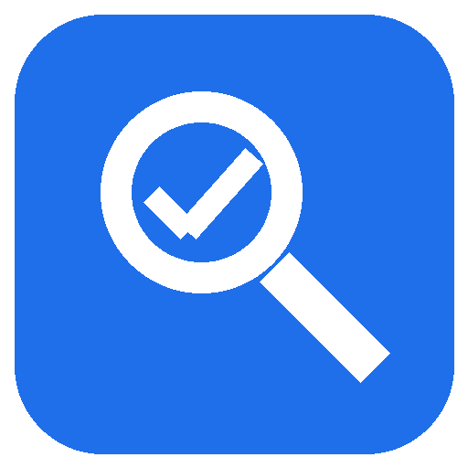

# OfacMatch plugin



Screen person, company, vessel and aircraft names against the U.S. Treasury OFAC Specially Designated Nationals (SDN) list, and see why each potential match scored the way it did: which listed name or alias it hit, how each part of the name paired up, and whether a year of birth or country conflicts with the listed record.

## What's included

- **MCP server `ofac-match`**, with five read-only tools:
  - `screen_name`: screen one name and explain each potential match.
  - `screen_names`: screen up to 100 names and return the best match for each.
  - `get_sanctions_entry`: show the full published record of an SDN entry.
  - `compare_names`: show how two names score against each other, part by part.
  - `get_list_info`: report which copy of the SDN list is loaded and when it was downloaded.
- **Skill `ofac-screening`**: tells Claude how to run a screening and report the results responsibly, as potential matches for a person to review, never as a decision.

## Install

In Claude Code:

```
/plugin install ofac-match --marketplace krunalsolanki/ofac-match
```

On older Claude Code versions, add the marketplace first, then install:

```
/plugin marketplace add krunalsolanki/ofac-match
/plugin install ofac-match@ofac-match
```

## Requirements

The server is the [OfacMatch.Mcp](https://www.nuget.org/packages/OfacMatch.Mcp) NuGet package, version 0.1.2, started with `dnx`. It needs the [.NET 10 SDK](https://dotnet.microsoft.com/download/dotnet), which includes `dnx`.

## What it runs, sends and fetches

- **Runs:** `dnx OfacMatch.Mcp@0.1.2 --yes`, which downloads that exact package version from nuget.org the first time and starts it on your computer.
- **Fetches:** the public SDN list (SDN.CSV, ALT.CSV, ADD.CSV) from OFAC's Sanctions List Service at `https://sanctionslistservice.ofac.treas.gov`, cached on your computer for 24 hours.
- **Sends:** nothing. The names you screen are processed locally and never leave your computer.

Source code: https://github.com/krunalsolanki/ofac-match

## Privacy Policy

OfacMatch collects nothing: no accounts, analytics or telemetry. Screening happens on your own computer, and the only network request is the download of OFAC's public list, which contains none of your data. The cached list is stored in `%LOCALAPPDATA%\OfacMatch\sdn` on Windows, `~/Library/Application Support/OfacMatch/sdn` on macOS and `~/.local/share/OfacMatch/sdn` on Linux; delete it any time. Nothing is shared with third parties and nothing about you is retained. Full policy: https://github.com/krunalsolanki/ofac-match/blob/main/PRIVACY.md. Contact: https://github.com/krunalsolanki/ofac-match/issues.

## Responsible use

Results are potential matches only. A score says how alike two names are written, not whether two records are the same party. A person must review each match against the full record before any decision. This is not legal advice.

## License

Apache License 2.0. See [LICENSE](LICENSE).
